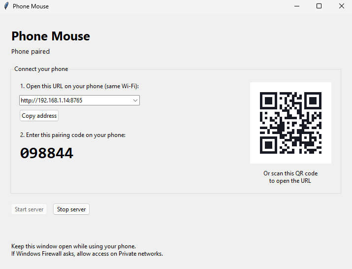
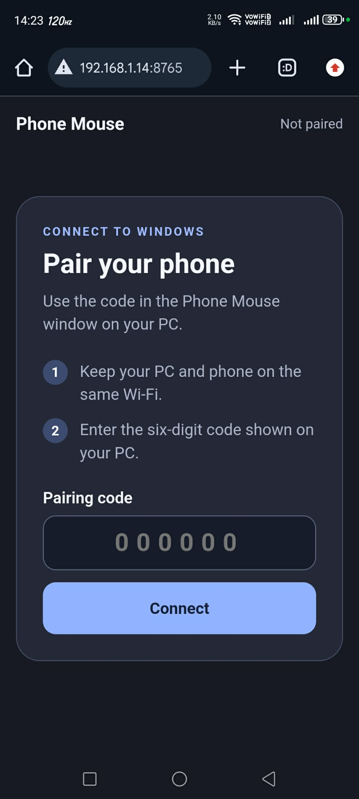
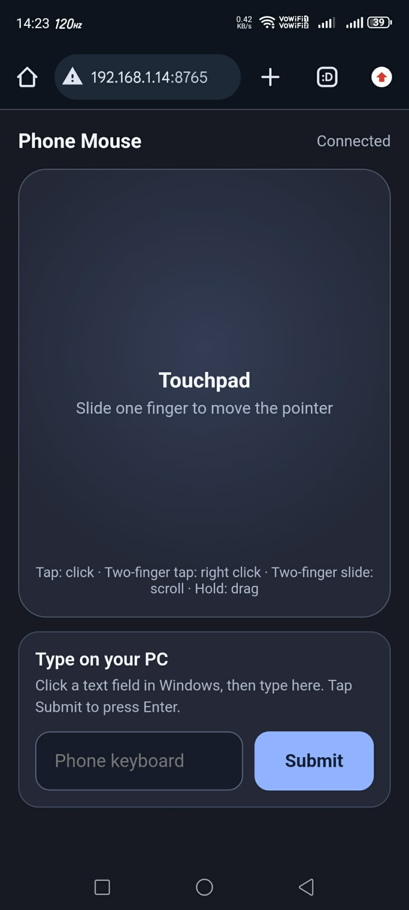

# Phone Mouse

Control your Windows mouse from a phone browser on the same Wi-Fi network. The phone's own keyboard types text into the currently focused Windows app.

[Download the Windows EXE](dist/PhoneMouse.exe)

## Screenshots

Windows app (`PhoneMouse.exe`):



Phone pairing and touchpad:

 

## Start the Windows app

1. Open `dist/PhoneMouse.exe` on your Windows PC. No Python installation is needed to run the EXE. The app waits for an active Wi-Fi connection before showing the QR code and pairing code; it starts automatically when Wi-Fi connects.
2. Scan the QR code with your phone's camera, or open the address shown in the app. Both devices must be on the same Wi-Fi network. If the QR code does not connect, choose another address in the Windows app and scan the updated code.
3. Enter the six-digit pairing code shown in the app.

Slide one finger on the large touchpad to move the pointer. Tap with one finger to left click, tap with two fingers to right click, and slide two fingers to scroll. Press and hold with one finger to drag. To type, focus a text field on the PC, then tap the phone's typing field; its keyboard sends text to Windows as you type. Tap **Submit** on the phone to press Enter on Windows. Keep the Windows app open while using your phone; **Stop server** disconnects the phone.

If Windows Firewall asks, allow Phone Mouse on your home network. If the QR page is unreachable, choose the Wi-Fi address in the Windows app, turn off the phone's VPN, and check whether your router isolates wireless devices. The app runs over local HTTP; do not forward port 8765 to the internet or use it on an untrusted Wi-Fi network. Restarting the server resets the pairing code and disconnects the phone.
If the PC changes or loses its Wi-Fi address, the app refreshes the QR code and pairing code when the connection returns.

Windows may reject simulated input on secure screens and in apps running with higher privileges than Python. The app sends text as Unicode key events without changing the PC clipboard.

## Test

Install the source dependencies with `python -m pip install -r requirements.txt`, then run `python -m unittest -v` to check pairing, request validation, live text edits, drag release, address selection, and QR rendering. Test touch gestures and typing on a Windows PC with a phone; the automated tests use a fake input device.

## Rebuild the EXE

With Python installed on Windows, install the dependencies (`python -m pip install -r requirements.txt pyinstaller`), then run:

```powershell
python -m PyInstaller --noconfirm --onefile --windowed --name PhoneMouse --add-data "index.html:." app.py
```

The finished file is `dist/PhoneMouse.exe`. You can also run the app from source with `python app.py`.
